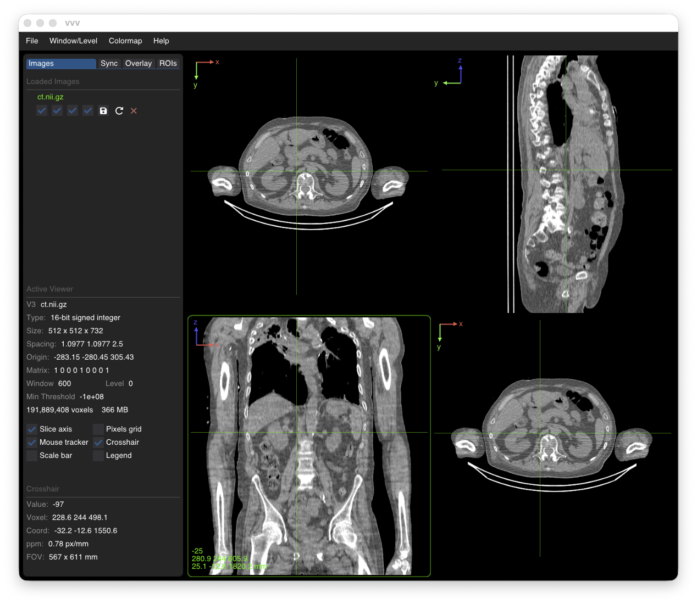
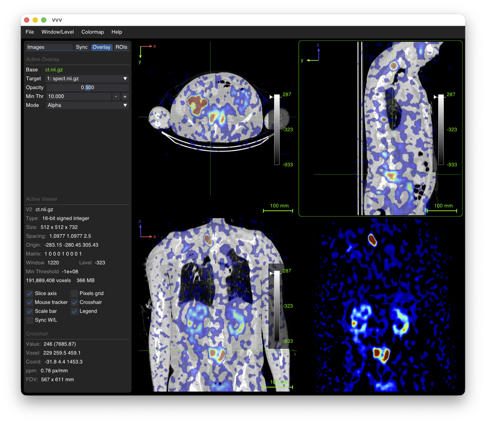
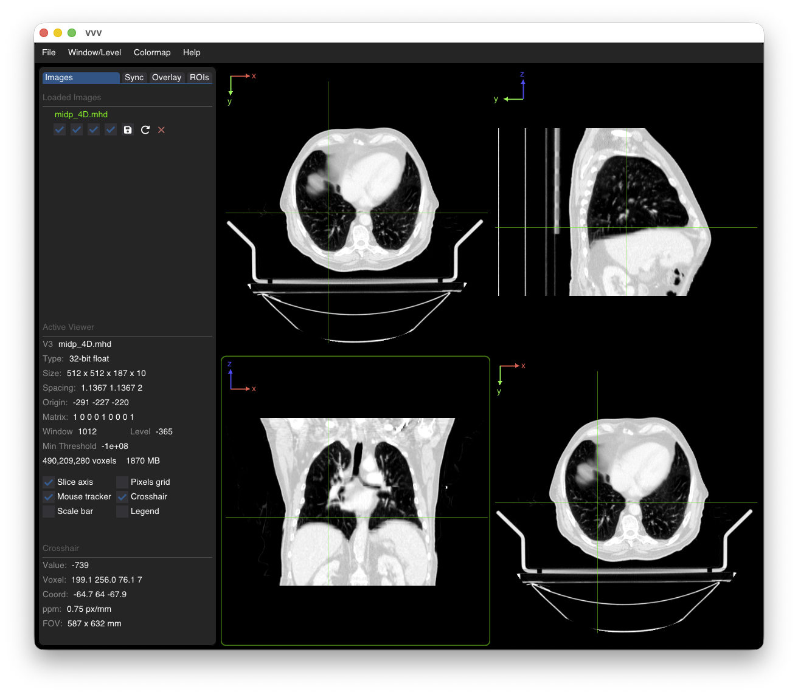
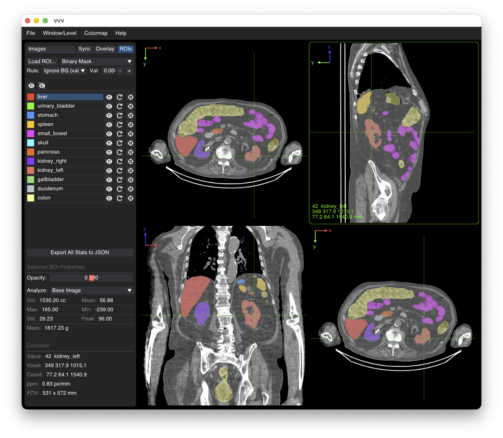
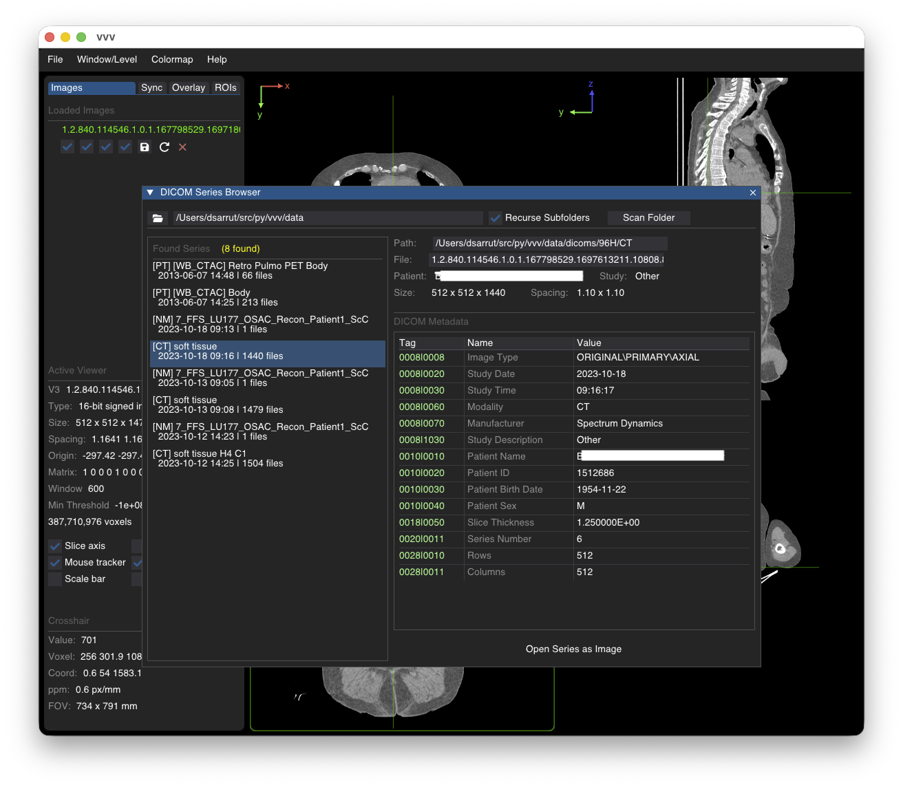

# VVV

**VVV** is a fast, research-oriented, and minimalist 3D/4D (medical) image viewer, conceived as a modern Python successor to [VV](https://github.com/open-vv).

📖 **[Complete User Documentation](user_docs/README.md)** | **[Getting Started Guide](user_docs/doc_01_overview.md)** | **[CLI Reference](user_docs/doc_03_command_line.md)**

---

## Highlights

- **Fast & Minimalist:** Instant startup, keyboard and command-line driven.
- **Multi-Planar Reconstruction (MPR):** Seamless switching between Axial (`F1`), Coronal (`F2`), and Sagittal (`F3`) planes.
- **Formats & 4D Support:** Reads standard medical formats (`.nii`, `.nii.gz`, `.mha`, `.mhd`, `.nrrd`, `.dcm`, etc.) and multi-frame 4D series (cardiac/respiratory phases).
- **Sub-Pixel Synchronization:** Synchronize pan, zoom, and crosshair slices across multiple image viewers.
- **Image Fusion & Overlays:** Alpha blending, checkerboard, difference maps, colormaps, and displacement vector fields (DVF).
- **ROIs & RT-STRUCT:** Native sub-pixel RT-STRUCT contour rendering, binary masks, and interactive thresholding.
- **Radiotherapy Tools:** Quantitative dose visualization, isodose contours/wash, and interactive Dose-Volume Histograms (DVH).
- **Measurement & Alignment:** 1D line profiles (`P`), 3D point landmarks, publication legends (`L`), and 6-DOF manual rigid registration.
- **Sessions & Workspaces:** Save and reload full multi-viewer workspaces (`.vvw`), with automatic history.

> **In-App Help:** Click the **"baby" icon** at the bottom-left of the application to display interactive guides, shortcuts, and tooltips directly inside the UI.

---

## Installation

```bash
pip install open-vvv
```

Or install the development version from source:

```bash
git clone https://github.com/dsarrut/vvv
cd vvv
pip install -e .
```

<details>
<summary><b>Linux Note (Clipboard support for screenshots)</b></summary>

On Linux, copying screenshots directly to the system clipboard requires `xclip` (X11) or `wl-clipboard` (Wayland):
```bash
sudo apt install xclip         # Ubuntu / Debian (X11)
# or: sudo apt install wl-clipboard   # Ubuntu / Debian (Wayland)
# or: sudo dnf install xclip          # Fedora / RHEL
```
If neither is installed, screenshots are automatically saved to `~/Pictures/vvv_screenshot_<timestamp>.png` (or `~/vvv_screenshot_...png`).
</details>

---

## Quick Start (CLI)

```bash
# View a single image
vvv ct.nii.gz

# Open two images synchronized
vvv ct.nii.gz spect.nii.gz -s

# Fuse two images with a colormap
vvv ct.nii.gz, spect.nii.gz, jet

# Overlay an image with a binary mask
vvv ct.nii.gz + labels.nii.gz

# Restore a saved session
vvv my_session.vvw
```

For more CLI options and syntax, see the **[CLI Documentation](user_docs/doc_03_command_line.md)**.

---

## Screenshots

| Single 3D Image | Image Fusion |
| :---: | :---: |
|  |  |

| 4D Sequence | ROI Contours |
| :---: | :---: |
|  |  |

| DICOM Series Browser |
| :---: |
|  |

---

## User Documentation

Explore the detailed topic guides in [`user_docs/`](user_docs/README.md):

- [01. Overview & Interface](user_docs/doc_01_overview.md)
- [02. Working with Images](user_docs/doc_02_images.md)
- [03. Command-Line Interface](user_docs/doc_03_command_line.md)
- [04. Workspaces & Sessions](user_docs/doc_04_workspaces_and_sessions.md)
- [05. Multi-Viewer Synchronization](user_docs/doc_05_synchronisation.md)
- [06. Fusion & Overlays](user_docs/doc_06_fusion_and_overlays.md)
- [07. Intensity, Units & Colormaps](user_docs/doc_07_intensity_and_units.md)
- [08. ROIs & Contours](user_docs/doc_08_roi_and_contours.md)
- [09. Interactive Thresholding](user_docs/doc_09_thresholding.md)
- [10. Line Profiles](user_docs/doc_10_profiles.md)
- [11. 3D Landmarks](user_docs/doc_11_landmarks.md)
- [12. Rigid Registration](user_docs/doc_12_registration.md)
- [13. Maximum Intensity Projection (MIP)](user_docs/doc_13_mip.md)
- [14. Displacement Vector Fields (DVF)](user_docs/doc_14_dvf.md)
- [15. DICOM Browser](user_docs/doc_15_dicom.md)
- [16. Radiation Dose & DVH](user_docs/doc_16_dose.md)

---

*VVV has been carefully crafted with AI assistance (mostly Gemini, Claude) following the spirit of VV, focusing on performance, clean architecture, and research productivity.*
