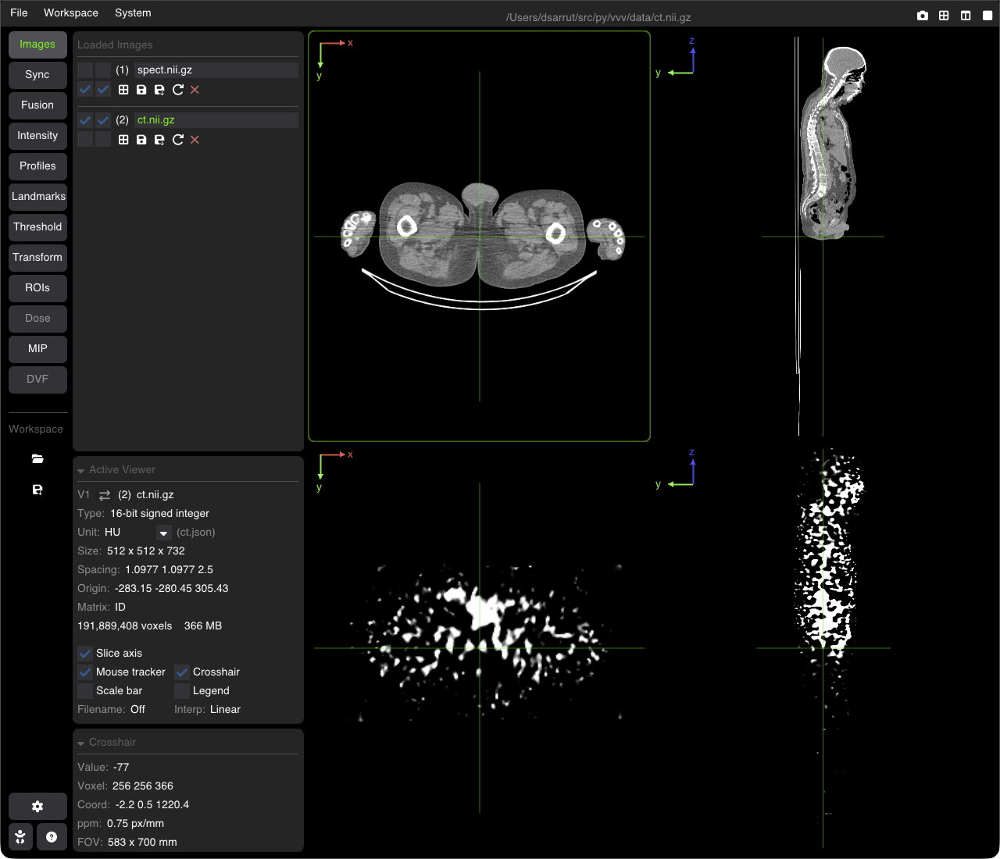
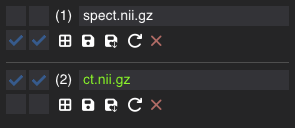
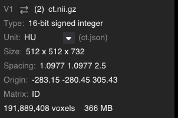

# Working with Images

VVV supports loading, managing, and inspecting multi-dimensional medical and scientific images in physical space.



---

## Supported Formats

VVV relies on SimpleITK and native loaders to read standard medical imaging and scientific volume formats:

| Format | Extensions | Description |
| :--- | :--- | :--- |
| **NIfTI** | `.nii`, `.nii.gz` | Standard neuroimaging & general 3D/4D volumes |
| **MetaImage** | `.mha`, `.mhd` | Medical volumes with detached/attached raw headers |
| **NRRD** | `.nrrd`, `.nhdr` | Nearly Raw Raster Data |
| **DICOM** | Directory or `.dcm` | CT, MR, PET, RT-Dose, RT-Struct series |
| **4D Sequences** | `.nii.gz`, `.mha` | Dynamic/cardiac series, 4D respiratory phases |
| **Displacement Fields (DVF)** | `.nii.gz`, `.mhd` | 3D deformation vector fields (3-component displacement) |
| **Scientific Images** | `.tif`, `.png`, `.jpg` | 2D/3D microscopy or biomedical images |

---

## Loading Images

You can load images through multiple convenient ways:
* **Drag and Drop**: Drag image files or DICOM folders onto the VVV window. Dropped workspaces (`.vvw`) are opened after the images, in order (the last one becomes the current workspace).
* **Top Menu**: **File** $\rightarrow$ **Open Image(s)...** (<kbd>Ctrl+O</kbd> / <kbd>Cmd+O</kbd>), **Open Recent...**, **Open DICOM Browser...** (see [DICOM](doc_15_dicom.md)) or **Open a 4D Sequence...**.
* **Command Line**: Launch with filenames as positional arguments:
  ```bash
  vvv data/crop_ct.nii.gz data/spect.nii.gz
  ```

---

## The Images Tab

The **Images** tab on the left sidebar lists all volumes currently loaded in memory:



### 1. Viewport Assignment (V1–V4 Checkboxes)
The $2\times 2$ checkbox grid assigns the image to any of the active viewports:
* **V1** (top-left) &nbsp;|&nbsp; **V2** (top-right)
* **V3** (bottom-left) &nbsp;|&nbsp; **V4** (bottom-right)

Checking a box displays the volume in that viewport. Multiple viewports can display the same image simultaneously with independent zoom, slice position, or orientation.

### 2. Renaming Images
* Click the name field, type the new name, then press <kbd>Enter</kbd> (or click elsewhere).
* The new name updates across all viewports and info panels.
* The number in front of the name, e.g. **(2)**, identifies the image everywhere (viewer overlays, fusion target, plugin titles). It is given in load order and kept while the image is open: closing an image does not renumber the others.

### 3. Action Buttons
Each image entry features a row of quick actions:
* **Show in all viewers**: shows the image in all 4 viewers.
* **Save**: saves the image back to its file (and its unit to its `.json` [side-car file](doc_17_side_car_files.md)).
* **Save As**: saves the image to a new file path and format.
* **Reload**: reads the image again from disk. When the file changed on disk (or the voxels were changed in vvv), the name is shown in orange.
* **Close** (last): unloads the image from memory.

### 4. 4D Time Slider
For a 4D image, a time slider (`4D` ... `/ N`) follows the action buttons on the same row; <kbd>←</kbd> / <kbd>→</kbd> also change the frame.

---

## Active Viewer & Image Metadata

When clicking on any viewport, it becomes the **Active Viewer** (highlighted border). The sidebar panels reflect its properties:



### Physical Metadata & Base/Fusion Toggle
* **⇄ (Toggle Base / Fusion Info)**: the icon button `⇄` left of the image name (enabled when the active viewer has a Fusion overlay) toggles the panel between the **Base image** metadata and the **Fusion overlay image** metadata (the viewer display does not change). The image number `(n)` follows it.
* **Type**: Voxel data type (e.g. `int16`, `float32`).
* **Unit**: Physical intensity unit. Click the dropdown arrow <kbd>▾</kbd> to assign presets (`HU`, `SUV`, `SUL`, `Bq/mL`, `kBq/mL`, `Gy`, `counts`, `a.u.`) or type a custom unit (`?` = unknown). Its source follows in brackets, e.g. `(ct.json)`: the unit is kept in a [side-car file](doc_17_side_car_files.md) next to the image. After a change, a save icon writes the unit alone to that file.
* **Size**: Voxel grid dimensions $(N_x \times N_y \times N_z)$.
* **Spacing**: Physical voxel spacing $(\Delta x, \Delta y, \Delta z)$ in mm.
* **Origin**: Real-world physical origin $(X_0, Y_0, Z_0)$ in mm.
* **Matrix**: Orientation and direction cosine matrix. Hover over the field to inspect the full $3\times 3$ transformation matrix.
* **Memory**: Approximate RAM footprint of the volume in memory.

### Visibility Overlays
Below the metadata fields, quick checkboxes toggle viewport annotations:
* **Slice axis**: Colored coordinate axes indicating anatomical orientation.
* **Profiles**: the profile lines (see [Profiles](doc_10_profiles.md)).
* **Pixels grid**: Voxel boundary grid lines when zoomed in at high magnification.
* **Mouse tracker**: Real-time cursor coordinates and intensity reading.
* **Crosshair**: Interactive intersection crosshair.
* **Scale bar**: Calibrated physical distance bar in mm.
* **Legend**: Colormap intensity calibration bar and unit label.
* **Filename**: the image name on the viewer: **Off**, **Short** or **Full** (click to cycle).
* **Interp**: the zoom interpolation: **Linear** (smooth), **NN** (pixelated, also <kbd>K</kbd>) or **Stripe** (for an extreme zoom).

### Crosshair Readout
The **Crosshair** panel provides real-time point measurements (click its title to fold it; it folds by itself in a window less than 800 px high):
* **Value**: Voxel intensity directly under the crosshair.
* **Voxel**: Discrete grid index $(i, j, k)$.
* **Coord**: Physical position $(X, Y, Z)$ in mm.
* **ppm**: Pixels-per-millimeter (current zoom level).
* **FOV**: Current visible field of view in mm $(W \times H)$.

