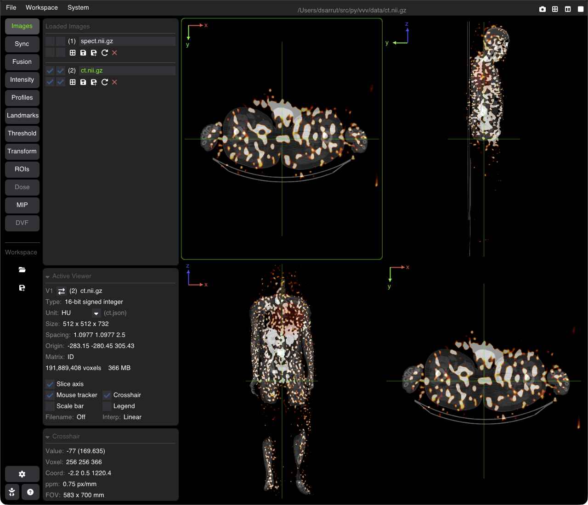

# Command-Line Interface (CLI)

VVV provides a rich command-line interface to launch directly into multi-image layouts, fusion overlays, synchronization groups, label maps, and workspaces.



```bash
vvv data/ct.nii.gz,data/spect.nii.gz,hot,0.6 + data/Sphere_1.nii.gz
```

---

## Basic Usage

Launch with one or more images:

```bash
# Open a single image
vvv patient_ct.nii.gz

# Open multiple images in side-by-side viewports
vvv ct.nii.gz spect.nii.gz dose.nii.gz
```

---

## Overlay & Fusion Syntax

Attach an overlay to a base image using a **comma-separated syntax**:

```
vvv <base>[,<overlay>][,<colormap>][,<opacity>][,<min_threshold>]
```

| Field | Description | Default / Options |
| :--- | :--- | :--- |
| **base** | Base image path | Required |
| **overlay** | Fused overlay image path | Optional |
| **colormap** | Overlay colormap (any case), or `reg` / `registration` for the Registration fusion mode (red / green) | `jet` (default), `hot`, `cold`, `dosimetry`, `grayscale`, `segmentation` |
| **opacity** | Blending alpha ($0.0$ to $1.0$; out of range: clamped) | `0.5` |
| **min_threshold** | Overlay voxels below this value are not shown | None |

Without an overlay (empty second field), the colormap and the threshold apply to the base image: `vvv spect.nii.gz,,hot,,0.5`.

### Examples

```bash
# Standard alpha fusion with default Jet colormap (opacity 0.5)
vvv ct.nii.gz,spect.nii.gz

# Fusion with Hot colormap at 70% opacity
vvv ct.nii.gz,spect.nii.gz,hot,0.7

# Clip low background intensities (threshold at 150)
vvv ct.nii.gz,spect.nii.gz,hot,0.6,150

# Registration fusion mode (red / green, grayscale colormaps)
vvv fixed.nii.gz,moving.nii.gz,reg

# Apply a colormap to the base image without an overlay (empty second slot)
vvv spect.nii.gz,,hot
```

---

## Multi-Viewer Synchronization

Link viewports together at launch:

```bash
# Synchronize all images spatially (pan, zoom, slice crosshair)
vvv ct.nii.gz spect.nii.gz --sync      # or -s

# Synchronize Window/Level contrast across all images
vvv mri_t1.nii.gz mri_t2.nii.gz --linkall-wl    # or -lw

# Synchronize both spatial navigation and Window/Level
vvv ct_pre.nii.gz ct_post.nii.gz -s -lw

# Assign specific synchronization groups (group_id:image)
vvv 1:ct.nii.gz 1:spect.nii.gz 2:mr1.nii.gz 2:mr2.nii.gz
```

---

## Label Maps & ROIs

Attach binary or multi-label segmentations to a base volume using `+`:

```bash
# Load label map as colored ROI contours on the CT volume
vvv ct.nii.gz + organs.nii.gz

# Combine fusion overlay and multiple ROI masks
vvv ct.nii.gz,spect.nii.gz,hot,0.6 + tumor.nii.gz + bladder.nii.gz
```

---

## 4D Sequences & Dynamic Series

Stack multiple 3D timeframes into an interactive 4D volume:

```bash
# Explicit 4D sequence tag
vvv 4D phase0.nii.gz phase1.nii.gz phase2.nii.gz phase3.nii.gz

# Shell glob: the sequence stops at the first file with another size or spacing
vvv 4D frame_*.nii.gz

# End a sequence with // (or ::, stop:, end:), then other images
vvv 4D phase*.nii.gz // ct.nii.gz
```

* The tag can also be written `4D:`, `SEQ`, `SEQUENCE` (any case).
* Without a tag, files are separate images, even when they have the same size.
* A `4D` tag after an image starts a new item: `vvv ct.nii.gz 4D phase*.nii.gz` opens the CT and the sequence.

---

## Workspaces & Saved Sessions

Restore a complete workspace session (`.vvw`) saved from a previous run:

```bash
vvv my_analysis.vvw

# Images first, then each workspace in order
vvv ct.nii.gz a.vvw b.vvw
```

With several workspaces, all their images are loaded; the last workspace sets the layout and the active viewer, and is the one **Save** / **Reload** act on. See [Workspaces](doc_04_workspaces_and_sessions.md).

---

## How the Arguments Are Read

* **Missing or unreadable files** are reported (`vvv: cannot open ...`) and the rest is opened; if nothing at all can be opened, vvv does not start.
* **`,` and `+` inside an existing file name** are part of the name: `vvv my,ct.nii` opens one image, `vvv a+b.nii,pet.nii` is `a+b.nii` with the overlay `pet.nii`.
* **Labels** go to the image just before the `+` (`vvv ct.nii + organs.nii.gz mr.nii`: the labels are on the CT only). A `+` with nothing after it, or before any image, is reported and ignored.
* **Bad values** (`hot,abc`, an unknown colormap, extra fields) are reported and replaced by the default.

---

## Command Options Reference

| Flag | Short | Description |
| :--- | :--- | :--- |
| `--sync` | `-s` | Enable spatial synchronization across all images at startup |
| `--linkall` | `-l` | Same as `--sync` (from the old `vv`) |
| `--linkall-wl` | `-lw` | Enable Window/Level synchronization across all images |
| `--no-history` | `-nh` | Ignore cached camera/contrast history and launch with defaults |
| `--fast-gl` / `--no-fast-gl` | | Hardware nearest-neighbor zoom (on by default; Linux and Windows only) |
| `--debug` | | FPS overlay with graph, debug messages, and stop on internal errors |
| `--help` | `-h` | Display the built-in CLI help text |

