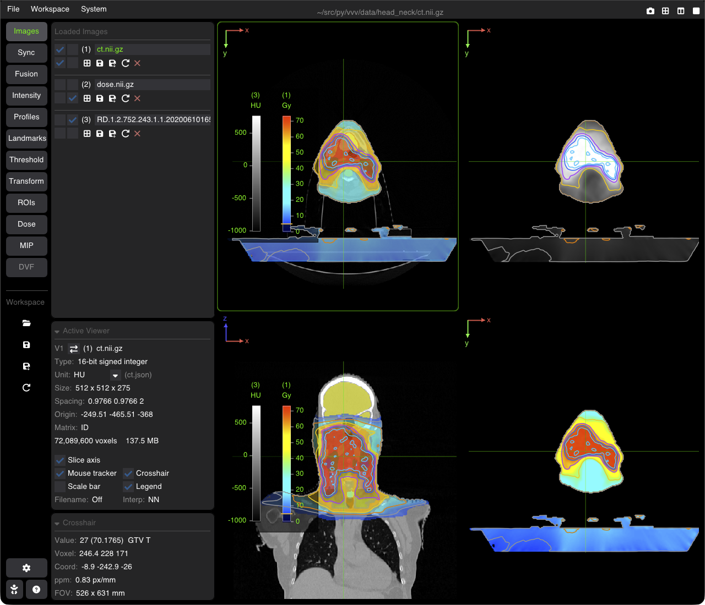

# Workspaces, Export & Screenshots

VVV allows saving and restoring complete multi-viewer visualization sessions using lightweight Workspace files (`.vvw`), as well as high-resolution image exports and automated screenshots.



---

## VVV Workspaces (`.vvw`)

A workspace file stores the entire state of your session in a clean, human-readable JSON format:
* **Loaded Datasets**: Base image paths, overlays, and ROI masks.
* **Viewer Configurations**: Multi-viewer layout (1, 2 or 4 viewers), the active viewer, assigned images, slice orientations (Axial, Coronal, Sagittal), zoom, and pan.
* **Synchronization Links**: Active synchronized viewer groups.
* **Radiometry & Visualization**: Window/Level settings, colormaps, opacity, and threshold bounds.
* **Analysis States**: Active landmarks and line profiles. Registration transforms are not stored: a transform saved next to its image (`ct.tfm`, a [side-car file](doc_17_side_car_files.md)) is applied again when the workspace is opened.

### Saving & Loading
The **Workspace** icons of the nav column and the **Workspace** menu:
* **Open Workspace**: opens a `.vvw` file (also by drag and drop, or from the terminal: `vvv data/dose.vvw`). Its images are added to the ones already open.
* **Save Workspace**: saves to the current workspace file (shown once a workspace is open or saved); hover the icon to see its name, path and content.
* **Save Workspace As**: saves to a new file, which becomes the current workspace.
* **Reload Workspace** (⟳): reloads the current workspace file as last saved: its images are closed and opened again; the other images stay. No confirmation is asked.

**Several workspaces** can be open together: each one adds its images, and the last one opened takes precedence (layout, active viewer) and is the current workspace (the one Save and Reload act on).
* **Dynamic Label Maps on Disk**: When a workspace referencing a multi-label segmentation map is reopened, VVV reads the actual label map image file currently on disk as the source of truth:
  * Any labels present in the file on disk are loaded.
  * Preferences saved in the workspace (custom names, colors, contours, visibility, and opacity) are reapplied to matching labels.
  * Labels removed from the file on disk since the workspace was saved are not loaded (preventing phantom or empty masks).
  * Newly added labels in the file on disk are automatically loaded with default colors and naming.

---

## Exporting High-Resolution Screenshots

VVV provides flexible tools for exporting clean, publication-ready figures:

### 1. Interactive Screenshot
* Click the **Screenshot** icon (camera icon at the right of the menu bar).
* **macOS & Windows**: Automatically copied directly to your system clipboard ready to paste into documents or presentation slides.
* **Linux**:
  * Copying directly to the clipboard uses `xclip` (on X11) or `wl-clipboard` (`wl-copy` on Wayland). These system utilities cannot be installed via `pip`:
    ```bash
    sudo apt install xclip         # X11
    sudo apt install wl-clipboard  # Wayland
    ```
  * If neither utility is installed, VVV gracefully falls back to automatically saving the captured image to `~/Pictures/vvv_screenshot_<timestamp>.png` (or `~/vvv_screenshot_<timestamp>.png`).

### 2. Automated Screenshots
Generating figures from a workspace without the interactive window is not available yet from the command line (planned).

