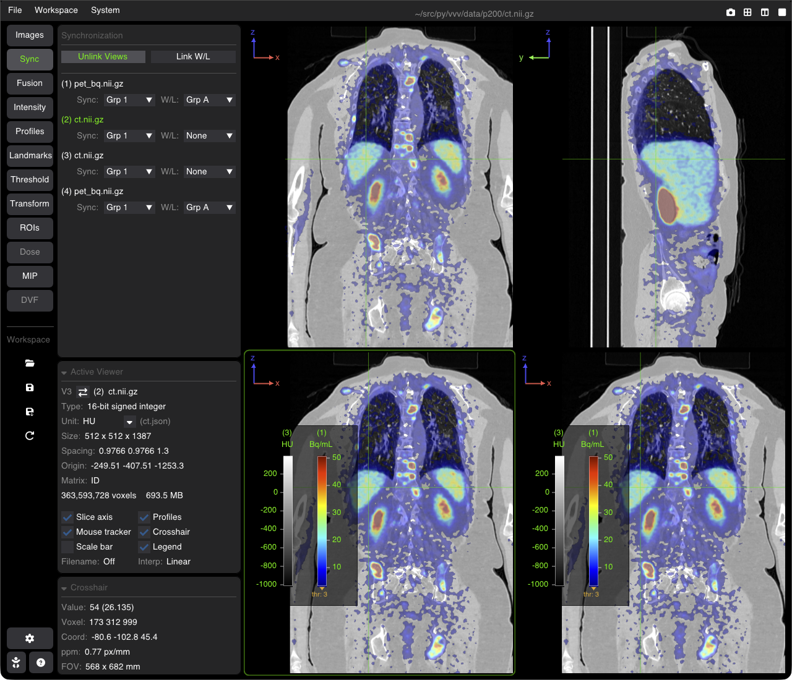
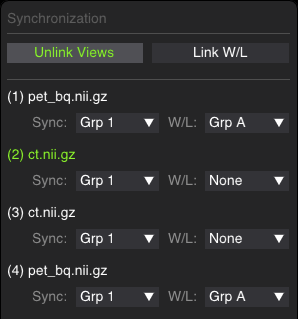

# Multi-Viewer Synchronization

VVV allows multiple images and viewports to synchronize in real time. Synchronization operates in physical space (mm), linking images regardless of differences in image matrix dimensions, voxel resolutions, or orientations.



---

## Synchronization Types

VVV distinguishes two independent synchronization modes:

| Mode | What is Synchronized | Scope |
| :--- | :--- | :--- |
| **Spatial Sync** (`Sync: Grp 1, 2...`) | Crosshair position, slice navigation, zoom scale (ppm), pan position, and 4D timeframes | Physical Space (mm) |
| **Window/Level Sync** (`W/L: Grp A, B...`) | Window width and level, minimum threshold, colormap, and fusion overlay opacity | Radiometric / Contrast |

---

## The Sync Tab

Open the **Sync** tab in the sidebar to manage synchronization groups for all loaded images:



### 1. Global Link Buttons
Two buttons on one row:
* **Link Views** / **Unlink Views**: puts all the images in Spatial Sync **Grp 1** (or unlinks them all).
* **Link W/L** / **Unlink W/L**: puts all the images in Window/Level Sync **Grp A** (RGB images are not changed by it).

A button is blue when all the images are linked; its tooltip says when they are only partly linked (`Partially linked (2/3 images)`).

### 2. Individual Group Selectors
Each loaded image has two independent dropdown selectors (`None`, then one group per loaded image):
* **Sync (`Grp 1`, `Grp 2`, ...)**: Numerical groups for spatial navigation. Images sharing the same number move in unison.
* **W/L (`Grp A`, `Grp B`, ...)**: Alphabetical groups for contrast. Images sharing the same letter share their contrast settings (disabled for RGB images).

---

## Keyboard Shortcuts

| Shortcut | Action |
| :--- | :--- |
| <kbd>S</kbd> | Link all images spatially (same as **Link Views**), or unlink them when they are all linked. |
| <kbd>Shift</kbd>+<kbd>S</kbd> | The same for Window/Level (**Link W/L**). |

---

## Command-Line Startup Flags

You can enable synchronization directly when launching VVV from the terminal:

```bash
# Link all images spatially at startup
vvv ct.nii.gz spect.nii.gz --sync        # or -s

# Link all images by Window/Level at startup
vvv t1.nii.gz t2.nii.gz --linkall-wl     # or -lw

# Link both spatial navigation and Window/Level
vvv scan1.nii.gz scan2.nii.gz -s -lw

# Assign explicit synchronization groups on launch
vvv 1:ct.nii.gz 1:spect.nii.gz 2:mr1.nii.gz 2:mr2.nii.gz
```

