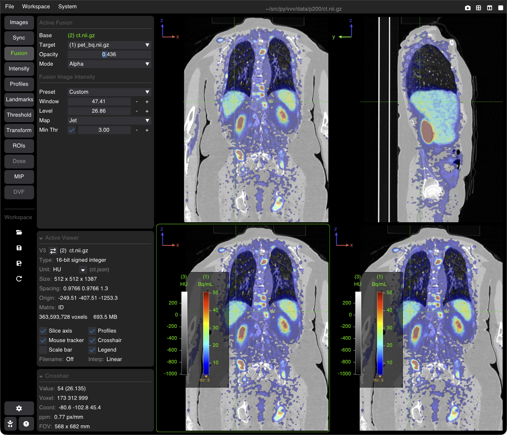
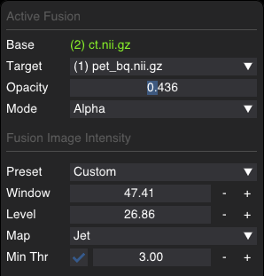

# Image Fusion & Overlays

VVV supports real-time multi-modal image fusion (e.g., PET/CT, SPECT/CT, Dose/CT, MRI/CT). Overlays are dynamically resampled and blended on the GPU in physical space (mm), accommodating differences in matrix resolution, voxel spacing, and patient orientation.



---

## Blending Modes

| Mode | Visual Representation | Use Case |
| :--- | :--- | :--- |
| **Alpha** | Semi-transparent color blend | Standard PET/CT, SPECT/CT, and radiation dose overlays |
| **Registration** | Red / green difference map (grayscale images) | Inspecting anatomical alignment between two scans |
| **Checkerboard** | Alternating square tiles of base and overlay | Verifying rigid or deformable registration accuracy |
| **DVF** | Displacement vectors drawn as arrows (set automatically for a DVF target) | Deformation vector fields and motion analysis (see [DVF](doc_14_dvf.md)) |

---

## The Fusion Tab

Select the **Fusion** tab in the sidebar to configure the overlay for the active viewer:



### 1. Active Fusion Setup
* **Base**: Displays the primary image shown in the active viewport.
* **Target**: Dropdown to choose a loaded image to blend on top of the base image (or `None` to disable); RGB images are not listed.
* **Opacity**: Slider adjusting overlay alpha transparency ($0.0 = \text{invisible}$ to $1.0 = \text{opaque}$). In Registration mode it is the **Balance** between the two images; in Checkerboard mode it is disabled.
* **Mode**: `Alpha`, `Registration` or `Checkerboard`. For a DVF target the mode is `DVF` and cannot be changed; on an RGB or DVF base image, only `Alpha` is available.
* **Checkerboard Controls** *(visible in Checkerboard mode)*: Adjust square tile size in mm and toggle square inversion (**Swap**).

### 2. Fusion Image Intensity
Controls the radiometric rendering of the **overlay image only**, leaving the base image contrast untouched:
* **Preset**: W/L presets: `Optimal`, `Min/Max`, `Binary Mask`, `CT: Soft Tissue`, `CT: Bone`, `CT: Lung`, `CT: Brain`, `PET: [0 - 5]`, `[0 - 10]`, `[0 - 15]`, `[0 - 20]` (the PET presets also set the threshold at 0); `Custom` once you change the values.
* **Window / Level**: Adjust contrast width and center level of the overlay.
* **Map**: Choose overlay colormap (`Hot`, `Cold`, `Jet`, `Dosimetry`, `Grayscale`, `Segmentation`).
* **Min Thr**: Minimum intensity threshold of the target (overlay) image, turned on by its checkbox (after the label), or by a click on its <kbd>−</kbd> / <kbd>+</kbd> buttons. Target voxels below this value are rendered fully transparent, removing background noise without altering tissue signal.

---

## Essential Controls & Shortcuts

| Action | Control |
| :--- | :--- |
| **Adjust Base Window/Level** | <kbd>Right drag</kbd> (or <kbd>Shift</kbd> + mouse move) on the image |
| **Auto Base Window/Level** | <kbd>W</kbd> |
| **Auto Overlay Window/Level** | <kbd>X</kbd> |
| **Hide / Show the Annotations** (crosshair, axis, scalebar, file name, profiles, contours; not the overlay) | <kbd>H</kbd> |

---

## Launching Fusion via CLI

```bash
# Standard Alpha fusion with Jet colormap at 50% opacity
vvv ct.nii.gz,spect.nii.gz

# Hot colormap at 65% opacity
vvv ct.nii.gz,spect.nii.gz,hot,0.65

# Hot colormap with background noise cutoff below intensity 120
vvv ct.nii.gz,spect.nii.gz,hot,0.65,120

# Registration check mode
vvv fixed_ct.nii.gz,moving_ct.nii.gz,reg
```

