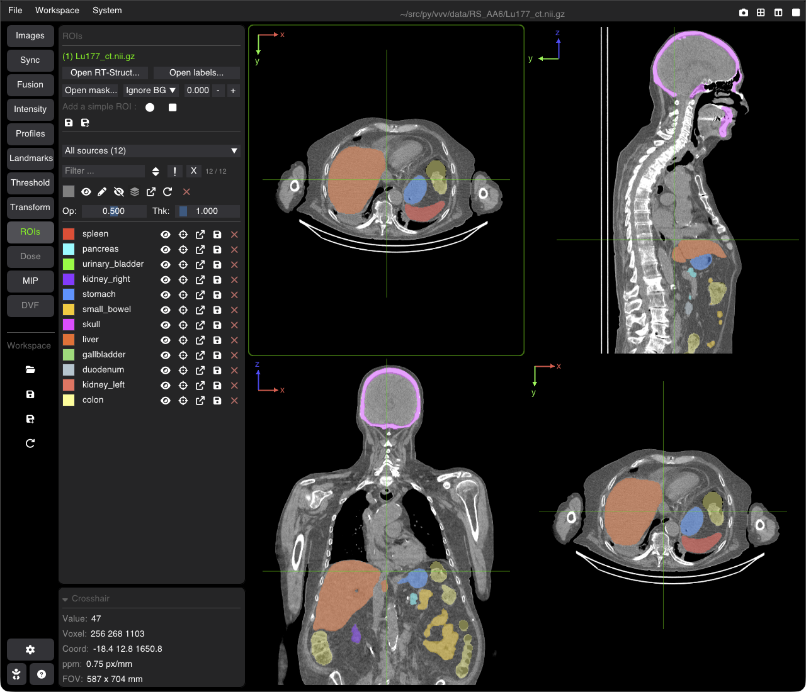

# Regions of Interest (ROIs) & Contours

VVV displays several segmentations at once, as filled masks (raster) or contours: binary masks, label maps (one ROI per label) and radiotherapy structure sets (RT-Struct). The ROIs belong to an image: they are listed in the **ROIs** tab for the image of the active viewer.

---

## Loading ROIs

In the **ROIs** tab:

* **Open RT-Struct...**: a DICOM RT-Struct file; a dialog lets you choose the structures to load.
* **Open labels...**: a label map (`.nii`, `.nii.gz`, `.mha`, `.mhd`, `.nrrd`, ...): one ROI per label value. The label names and colors come from its `.json` [side-car file](doc_17_side_car_files.md) (`labels.json` for `labels.nii.gz`), when there is one.
* **Open mask...**: a binary mask. The combo next to it says which voxels belong to the ROI: **Ignore BG (val)** (all voxels except the value given, 0 by default) or **Target FG (val)** (only the voxels with that value).
* **Command line**: label maps after a `+`: `vvv ct.nii.gz + labels.nii.gz` (see [Command line](doc_03_command_line.md)).

ROIs can also be created in vvv: **Add a simple ROI** creates a sphere (●) or a box (■) centered on the crosshair. The Threshold tool can make a mask image too (see [Thresholding](doc_09_thresholding.md)).

An ROI drawn outside the image grid is reported after loading.

---

## The ROI Tab Panel

### 1. Saving
* **Save** (floppy): saves the listed ROIs again, to the file of the last save.
* **Save As**: saves the listed ROIs either as **one multi-label image + its `.json` side-car** (label names and colors; option: sort the ROIs by volume, largest first, so that nested structures stay visible), or as **one file per ROI** (`<roi name>.nii.gz`; option: crop each ROI to its bounding box).

After a save, the saved ROIs come from the new file; the original file is not changed.

### 2. Listing: source, filter, batch buttons
* **Source**: when the ROIs come from more than one file, a combo lists them: **All sources (N)**, one item per file (e.g. `Labels · organs.nii.gz (3)`), and **Created (N)** for the ROIs made in vvv. Choose one to list only its ROIs.
* **Name filter**: type part of a name to list only the matching ROIs (case-insensitive). **`!`** inverts the filter, **X** clears it, the sort button orders the list (A→Z, Z→A, off). The count shows listed / total.
* **Batch buttons** (on the listed ROIs, or on the selected ones if any): color, **Show** (raster), **Contour**, **Hide**, ROI on top of the fusion overlay, statistics windows, **Reload** from disk, clear the selection, **Close**.
* **Op** / **Thk**: opacity of the filled masks and thickness of the contours, for all the ROIs.

### 3. The ROI list
Each row: the color, the name (click to rename), then the icons:
* **eye**: show filled / show as contour / hide;
* **center** the view on the ROI;
* **statistics** window of the ROI;
* **reload** (when its file changed on disk), **save**, **delete** (last).

Hover a name to see where the ROI comes from: its file, its label value (label map), and `Name and color from labels.json (side-car file)`.

Click a ROI to select it (<kbd>Esc</kbd> clears the selection); with the mouse over the list, <kbd>↑</kbd> / <kbd>↓</kbd> move the selection.

### 4. The selected ROI
Below the list, for the selected ROI: its **Thickness** and **Opacity**, and its statistics on the base image:
* **Vol** (cc), **Mean**, **Max**, **Min**, **Std**;
* **Peak**: the 95th percentile of the values inside the ROI;
* **Mass** (g): the volume times a density estimated from the mean value as for a CT in HU (`mean / 1000 + 1` g/cc), so only meaningful on a CT.
