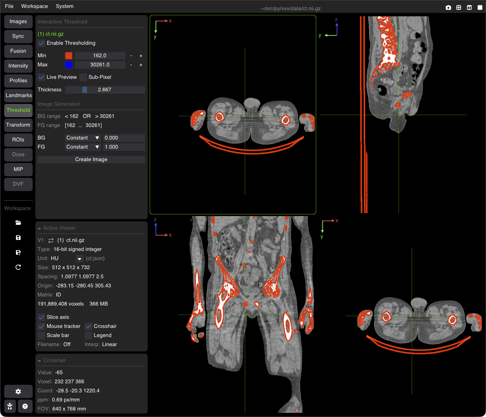

# Interactive Thresholding & Binary Masks

The **Threshold** tool shows, live on the image, the voxels whose value lies in a range [Min, Max], as colored contours. It can then turn that range into a new image (a binary mask, or the image kept inside / outside the range).

---

## Setting the Range

Open the **Threshold** tab of the nav column. The panel works on the image of the active viewer (its name is shown under the title **Interactive Threshold**).

* **Enable Thresholding**: turns the tool on for this image. The first time, Min starts at 0 (or the image minimum if it is above 0) and Max just above the image maximum.
* **Min** / **Max**: the range, with <kbd>−</kbd> / <kbd>+</kbd> step buttons (right-click them for a slower or faster step). Each bound has its own contour color (Min red, Max blue by default).
* **Live Preview**: draws the contours of the range on the image as you change it.
* **Sub-Pixel**: smooth contours (marching squares interpolation) instead of following the voxel edges.
* **Thickness**: contour line width (0.5–10).

The settings are kept per image, and saved in workspaces.

For a 4D image the preview shows the current frame (`Previewing Frame: 3 / 10`), for a displacement field the current component (`Previewing Component: dx`). The tool is not available for RGB images, or while MIP is on in the viewer.

---

## Image Generation

The **Image Generation** section turns the range into a new image:

* **BG range** / **FG range**: the voxels outside the range (`< Min OR > Max`) and inside it (`[Min ... Max]`).
* **BG** / **FG**: for each, **Constant** (a fixed value, 0 and 1 by default: a binary mask) or **Image** (the original voxel value is kept).
* **Create Image**: computes the new image (all frames of a 4D image) in the background and adds it to the image list as `Thr: <image name>`.

The new image is in memory only: save it from the **Images** tab (save icon) if you want to keep it. To use it as an ROI, save it, then open it with **Open mask...** in the ROI tab.
