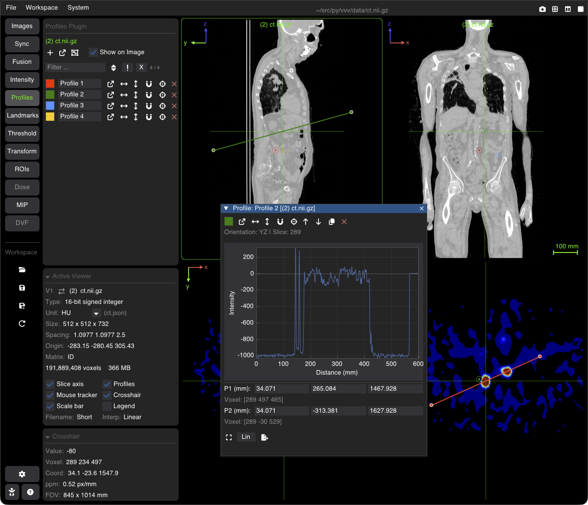

# 1D Line Profiles & Measurements

The **Profiles** tool plots the voxel values along a line segment, e.g. to check an edge, a resolution, a dose gradient or a value at a given depth.

---

## Adding & Adjusting Profiles

Open the **Profiles** tab of the nav column. The profiles belong to the image of the active viewer.

* **+** (or <kbd>P</kbd>): adds a horizontal profile line in the middle of the current slice (2/3 of the view width).
* Drag an **endpoint** of the line to move it, or the **middle** of the line to move the whole segment.
* Next to **+**: one button opens the plot windows of all profiles (or closes them, when any is open), another gathers the open plot windows at the bottom right of the window.
* **Show on Image**: shows or hides the profile lines on the viewers.
* **Name filter**: type part of a name to list only the matching profiles; **`!`** inverts the filter, **X** clears it, the sort button orders the list (A→Z, Z→A, off), and the count shows listed / total.

Each profile row: its color, its name (click to rename), then the icons: **plot** window, align **horizontal** / **vertical** on the current slice, **snap** the endpoints to the closest voxel centers, **go to** (center the view on the profile), and **delete** (last).

---

## The Plot Window

The plot shows the values of the image along the line, versus the distance from the first point in mm. The values are sampled with trilinear interpolation, on the image the profile belongs to.

* **P1 (mm)** / **P2 (mm)**: the physical coordinates of the endpoints; type new values to move them. Their voxel coordinates are shown below.
* The icons of the profile row (plot, horizontal, vertical, snap, go to), plus: move the profile to the **previous** / **next slice**, **copy** the profile to another image, and **delete**.
* **Fit**: rescales the plot to the data; **Lin** / **Log**: the Y axis scale (click to switch).
* **Export**: saves the profile to a JSON file: for each point, the distance (mm), the value, the physical position, the voxel coordinates and whether it is inside the image.

Pan and zoom in the plot with the mouse (drag, wheel), like any plot of vvv.
