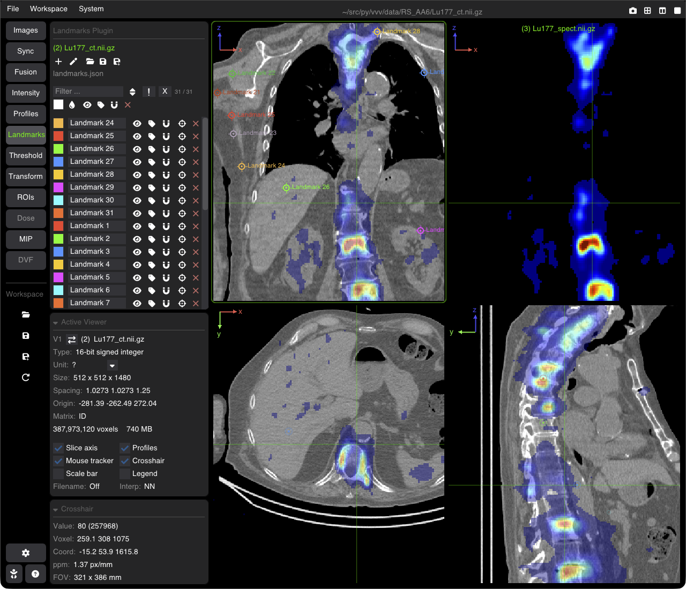

# 3D Point Landmarks & Navigation

The **Landmarks** tool places named 3D points (in mm) on an image, e.g. anatomical or fiducial points, and lets you go back to them.

---

## Placing Landmarks

Open the **Landmarks** tab of the nav column. The landmarks belong to the image of the active viewer.

* **+** (or <kbd>Space</kbd>): adds a landmark at the crosshair position.
* **Drag** a landmark on the image to move it.
* A landmark is drawn on its slice, and fades on the nearby slices.

---

## The Landmarks Panel

### Toolbar
**+**, **Enhanced visualization** (larger markers on the nearby slices with depth arrows `^` / `v`, high-contrast labels, a longer slice range), **Load**, **Save**, **Save As**, **Reload** (shown when the file changed on disk), then the file name.

* **Load**: a `.json` or `.csv` file.
* **Save** / **Save As**: the format follows the extension: `.json` (default name `landmarks_<image>.json`) or `.csv` (columns `ID, Name, X_mm, Y_mm, Z_mm, Color_R, Color_G, Color_B, Color_A, ...`).

### Listing and batch actions
* **Name filter**: type part of a name to list only the matching landmarks; **`!`** inverts the filter, **X** clears it, the sort button orders the list (A→Z, Z→A, off), and the count shows listed / total.
* **Batch buttons**, on the listed landmarks: color, reset colors, show / hide, show / hide names, snap to the voxel centers, delete (last).

### The list
Each row: the color, the name (click to rename), then the icons: **show / hide**, **show / hide the name**, **snap** to the nearest voxel center, **go to** (move the crosshair to the landmark), and **delete** (last).

The landmarks are saved in workspaces.
