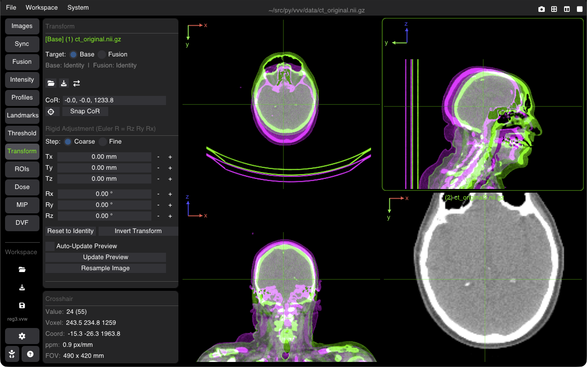

# Manual Rigid Image Registration

The Registration tool provides interactive manual rigid alignment (6 Degrees of Freedom: 3 translations, 3 rotations) between a fixed reference image and a moving floating image.

---

## Aligning Images

1. Load your reference and floating images into VVV (either as separate viewers or combined in a single viewer with a Fusion overlay).
2. Open the **Registration** (Transform) tab on the sidebar.
3. If the active viewer has a Fusion overlay, a **Target** switch (`[Base] [Fusion]`) appears, allowing you to select whether you are inspecting and adjusting the transform of the Base image or the Fusion overlay image. A summary line displays the status of both transforms (`Base: <file or Identity> | Fusion: <file or Identity>`).

---

## 6-DOF Transformation Controls

Use the interactive sliders or numeric step inputs to adjust the rigid transformation in real time:

### Translation ($\text{mm}$)
* **$T_x$**: Left / Right translation.
* **$T_y$**: Posterior / Anterior translation.
* **$T_z$**: Inferior / Superior translation.

### Rotation ($\text{degrees}$)
* **$R_x$ (Pitch)**: Rotation around the lateral axis.
* **$R_y$ (Roll)**: Rotation around the anteroposterior axis.
* **$R_z$ (Yaw)**: Rotation around the craniocaudal axis.
* **Center of Rotation (CoR)**: Pivot point around which rotations occur. Click the crosshair icon to jump to the CoR, or **Snap CoR** to set it to the current 3D crosshair position.
* **Invert Transform**: Invert the current transform matrix ($T \leftrightarrow T^{-1}$) at the click of a button (or via the top toolbar icon **⇄**).
* **Reset to Identity**: Resets all translations and rotations back to zero.

---

## Visual Verification Tools

To inspect the quality of the spatial alignment:
* **Checkerboard**: Interleaves alternating tiles of the fixed and moving images. Discontinuities in edges highlight misalignments.
* **Difference Image**: Subtracts normalized intensities to highlight residual differences.
* **Color Overlay**: Renders the fixed image in Green and the moving image in Magenta (or Red/Cyan) to evaluate anatomical overlap.
* **Flicker**: Quickly toggles visibility between fixed and moving images.

---

## Saving & Loading Transformations

* **Transform File Formats**: Standard ITK Transform (`.tfm`), as well as `.txt`, `.mat`, and Elastix parameter files.
* **Literature & ITK Coordinate Convention**: Files saved to and loaded from disk adhere to the standard ITK / literature convention ($T_{\text{disk}} = T_{\text{ITK}} = T_{\text{fixed} \to \text{moving}}$). In VVV's interactive viewport, forward spatial display coordinates ($T_{\text{moving} \to \text{world}}$) are used, ensuring intuitive forward slider movement while guaranteeing 100% interoperability with SimpleITK (`sitk.Resample`), Plastimatch, Elastix, and 3D Slicer without manual coordinate inversion.
* **Default Format & Naming**: When saving, the dialog pre-selects `.tfm` format with the image's name pre-filled (e.g. `patient.tfm`).
* **Automatic Transform Loading**: When an image is loaded, VVV automatically checks if a `.tfm` file with the same base name exists in the same directory (e.g. `patient.tfm` next to `patient.nii.gz` or `patient.mha`). If found, the transformation is automatically loaded and applied.
* **Resample & Bake**: Apply the transformation directly to the image volume grid (**Resample Image**) to permanently bake the alignment into the 3D voxel data.

---

## Shortcuts Summary

| Action | Shortcut |
| :--- | :--- |
| **Reset Transformation** | Click **Reset to Identity** |
| **Invert Transformation** | Click **Invert Transform** or top toolbar **⇄** |
| **Step Step Translations ($1\text{ mm}$)** | Arrow keys (when slider focused) |
| **Toggle Checkerboard** | Accessible via Fusion overlay modes |

