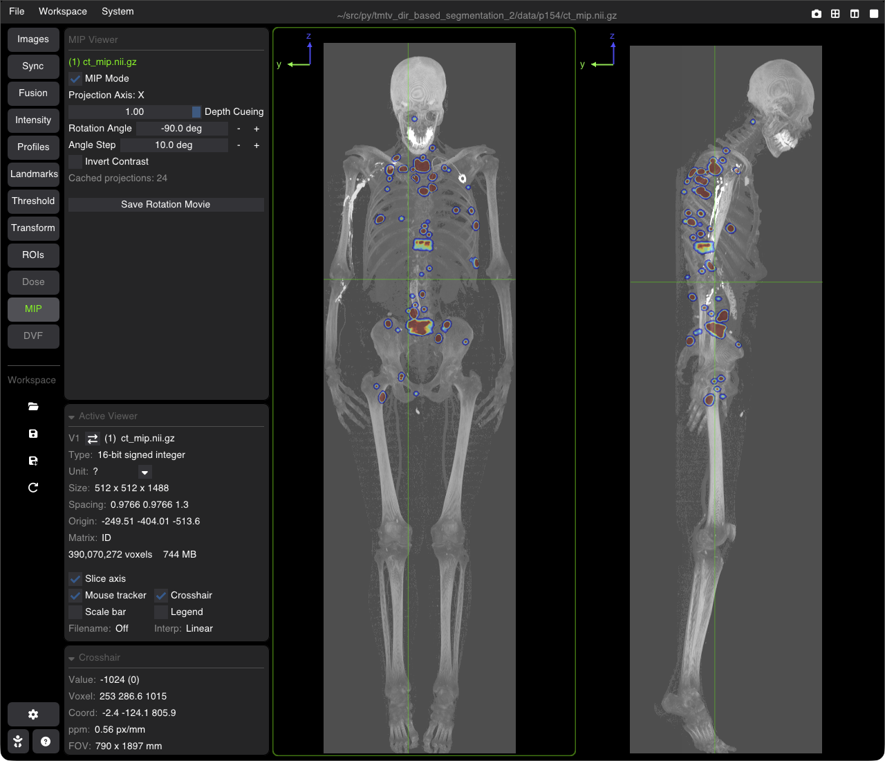

# Maximum Intensity Projection (MIP)

The **MIP** tool replaces the slice of a viewer by a Maximum Intensity Projection of the whole volume: each pixel shows the highest voxel value along the viewing direction. It is useful for PET / SPECT hot spots, contrast-enhanced vessels or bone.

---

## Using MIP

Open the **MIP** tab of the nav column. It works on the active viewer.

* **MIP Mode**: turns the projection on or off in the active viewer (shortcut <kbd>M</kbd>). The other controls are greyed out while it is off.
* **Projection Axis**: the viewing direction, given by the viewer orientation (change it with <kbd>F1</kbd> / <kbd>F2</kbd> / <kbd>F3</kbd>).
* **Depth Cueing** (0–1, default 1): dims the voxels that are far from the projection plane, which gives a sense of depth.
* **Rotation Angle** (−180° to 180°): turns the projection direction (the volume seems to rotate in front of you), with <kbd>−</kbd> / <kbd>+</kbd> step buttons.
* **Angle Step** (1°–45°, default 5°): the step of the <kbd>←</kbd> / <kbd>→</kbd> keys.
* **Invert Contrast**: shows the hot spots dark on a light background.
* **Cached projections: N**: the number of projections already computed for the viewer; going back to a cached angle is instant.
* **Save Rotation Movie**: saves an animated GIF of a full 360° turn of the projection, one frame per **Angle Step** (default name `mip_rotation_<image>.gif`).

If the `numba` package is not installed, a warning tells you that the projection will be slow.

---

## Keys (while MIP is on)

| Action | Key |
| :--- | :--- |
| Toggle MIP | <kbd>M</kbd> |
| Rotate the projection by one Angle Step | <kbd>←</kbd> / <kbd>→</kbd> |
| Previous / next frame of a 4D image | <kbd>↑</kbd> / <kbd>↓</kbd> |
