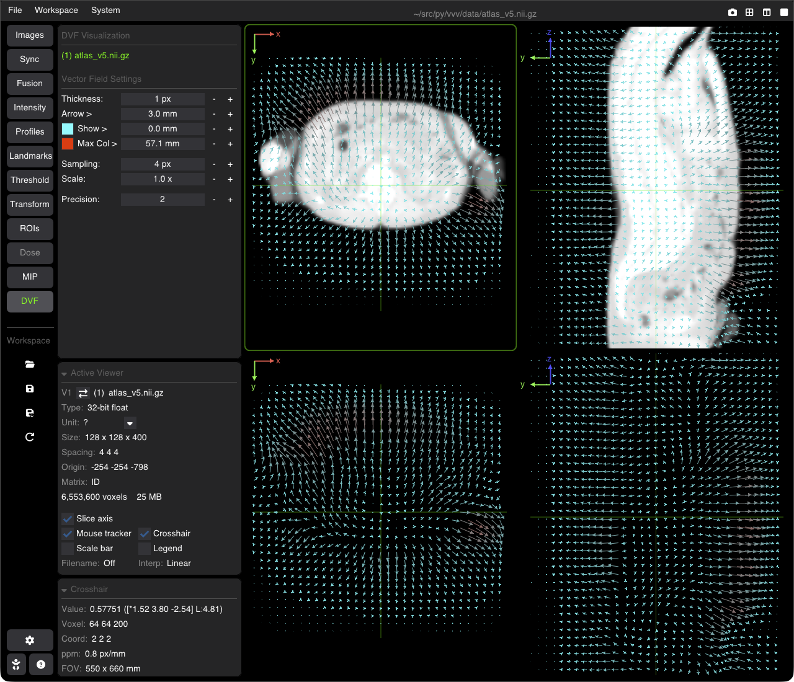

# Displacement Vector Fields (DVF)

VVV shows 3D Displacement Vector Fields (DVF), e.g. from a deformable image registration or a motion model: images with 3 components per voxel (the displacement Δx, Δy, Δz in mm).

---

## Opening a DVF

A DVF is opened like any image (menu, drag and drop, command line), from an ITK vector image (`.mhd`, `.mha`, `.nii.gz`, `.nrrd`, ...). It can be:

* **the base image** of a viewer: it is drawn with one of the three display modes below;
* **the fused image** over an anatomical image (**Fusion** tab, Target): it is drawn as vectors over the base image (the fusion mode is then **DVF**, set automatically), e.g. `vvv ct.nii.gz,dvf.mhd`.

The **DVF** tab of the nav column works on the DVF of the active viewer, base or fused. When the active viewer has no DVF, the panel says what it needs (*Needs a displacement vector field (vector image) as base or fused image.*) and what the current image is (e.g. *Current: scalar image (1 component per voxel)*); its controls are greyed out, and the DVF button of the nav column is muted.

---

## Display Modes (DVF as base image)

* **Component**: one component (X, Y or Z) as a scalar image; choose it with the 4D slider of the image list (or <kbd>←</kbd> / <kbd>→</kbd>).
* **RGB**: the three components as colors (X → red, Y → green, Z → blue).
* **Vector Field** (default): arrows drawn on the slice grid.

---

## Vector Field Settings

Shown for the Vector Field mode, and for a fused DVF:

* **Thickness** (px, default 1): line width of the vectors.
* **Arrow >** (mm, default 3): an arrowhead is drawn only on vectors longer than this.
* **Show >** (mm, default 0): vectors shorter than this are not drawn. Its color is the color of the small vectors (yellow by default).
* **Max Col >** (mm, default 10): vectors this long or longer get the second color (red by default); in between, the color goes from the first to the second.
* **Sampling** (px, default 5): spacing between the drawn vectors on the screen; higher is lighter and faster.
* **Scale** (default 1×): multiplies the drawn length of the vectors (display only).
* **Precision** (default 2): number of decimals of the displacement shown in the crosshair readout and the tracker.

Both colors can be changed with the color buttons of the **Show >** and **Max Col >** rows. The settings are kept per DVF and saved in workspaces.
