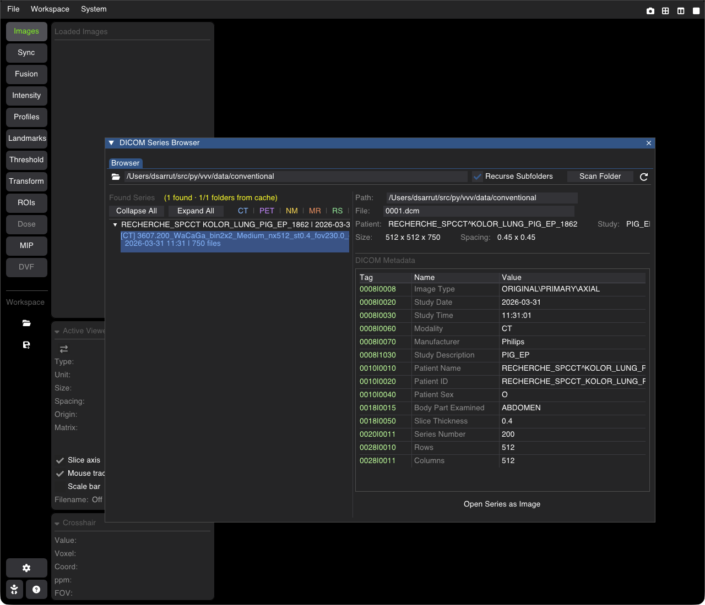

# DICOM Browser & Series Loading

The **DICOM Series Browser** scans a folder (and its sub-folders) for DICOM files, groups them into series, shows their tags, and opens a series as an image (or an RT-Struct as ROIs).

---

## Opening

* **Menu**: **File** $\rightarrow$ **Open DICOM Browser...** opens the browser window.
* **Command line**: `vvv /path/to/series_folder/` loads the DICOM series of that folder directly as an image (without the browser).

---

## Scanning

* Choose the folder with the folder icon (or type its path), keep **Recurse Subfolders** on to scan the sub-folders too, and click **Scan Folder**.
* **Scan cache.** The result of each scanned folder is kept in the vvv configuration folder (`dicom_cache/`, never in the scanned folders). The next scan of the same folder reuses it for every sub-folder whose files are unchanged (same names, sizes and modification times), so re-scanning a large tree takes a fraction of a second; changed folders are read again. The status shows how many folders came from the cache (`N/M folders from cache`). The ⟳ button next to **Scan Folder** rescans everything without the cache and rebuilds it.

---

## The Series List

* The series are grouped by patient, study date and frame of reference, the most recent first. **Collapse All** / **Expand All** fold the groups.
* The modality is shown in color: **CT**, **PET**, **NM**, **MR**, **RS** (RT-Struct), **DOSE**.
* Click a series to select it (one at a time); <kbd>↑</kbd> / <kbd>↓</kbd> move the selection. Its details are shown below: **Path**, **File**, **Patient**, **Study**, **Size**, **Spacing**, and its DICOM tags (Tag, Name, Value).

---

## Loading

* **Open Series as Image**: loads the selected series as an image.
* **RT-Struct**: for an RT-Struct series the button becomes **Load RT-Struct ROIs**: the structures become ROIs of their reference image (with their DICOM names and colors). The reference image is taken among the open images, or loaded first if it is in the scanned series; otherwise a message asks you to open it first.
* **RT-Dose**: dose series are scaled with their dose grid scaling factor, in Gy (see [Dose](doc_16_dose.md)).

Each image loaded from DICOM files gets its own tab in the browser window, with all its tags and a **Filter Tags** field.
