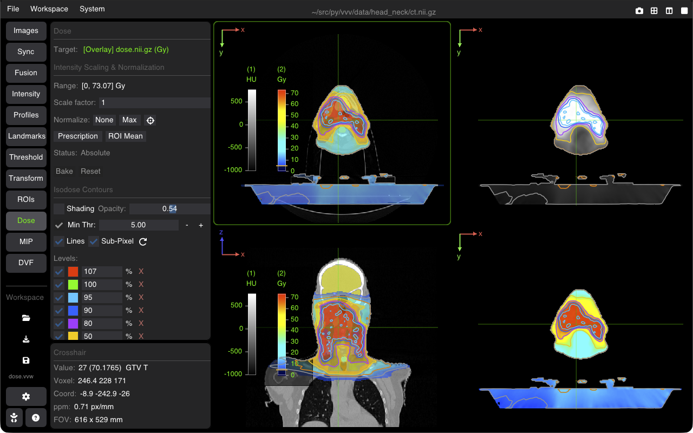
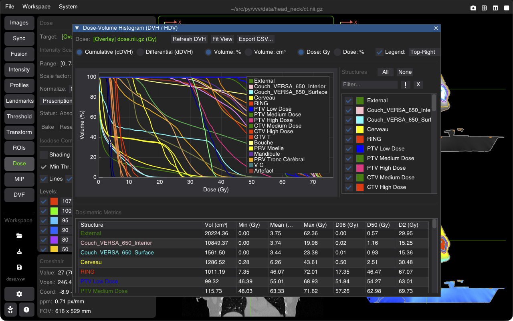

# Radiation Dose & Isodoses

The **Dose** tool provides quantitative radiotherapy, dosimetry, and nuclear medicine tools for radiation dose inspection, dose scaling, relative normalization, and interactive 2D isodose contour visualization.

---

## 1. Activation & Target Selection

The Dose plugin is strictly dedicated to volumes representing absorbed dose or dose rate.

### Activation Criteria

* The tool is automatically active when:
  * The active viewer's **Base image** has physical unit **`Gy`**, **`mGy`**, or **`Gy/decay`**.
  * **OR** the active viewer's **Fusion overlay** has unit **`Gy`**, **`mGy`**, or **`Gy/decay`**.
* **DICOM RTDOSE**: VVV automatically reads `DoseGridScaling` from DICOM RTDOSE series and sets `image.unit = "Gy"`. RTDOSE images therefore satisfy the activation requirement immediately upon loading.

### Inactive State (Dose Unit Required)

* When neither the base image nor the overlay has a Gy-compatible unit, the panel displays an informational banner:
  > *"Dose Unit Required: This tool is active when the base image or fused overlay has a Gy-compatible unit: Gy, mGy, or Gy/decay."*
* An **"Enable (Set unit to Gy)"** button is provided:
  * If an overlay is loaded: assigns unit `Gy` to the overlay volume.
  * Otherwise: assigns unit `Gy` to the base image volume.
  * Instantly activates the plugin controls.

### Automatic Dose Target

When active, the tool indicates its target dose volume (`Target: <Image Name>`):

* If a Fusion overlay represents a dose (e.g. anatomical CT base with RTDOSE overlay), the tool automatically targets the **overlay** layer.
* If the base image is a dose volume, it targets the **base** image.

---

## 2. Intensity Scaling & Normalization

The Dose tool features a comprehensive scaling and normalization engine shared with the Intensity component:

### Scaled Range Preview

* **Range**: Displays the real-time dynamic range `[min, max]` of the dose volume, taking into account the active user scale factor.

### User Scale Factor ($S$)

* **Scale factor**: Interactive numeric input (defaults to `1.0`). Allows applying an arbitrary physical multiplier $S$ to raw image values (e.g. converting between units, applying monitor units, or scaling Monte Carlo fractions).
* Works independently alongside prescription dose normalization.

### Normalization Controls

Easily switch between absolute physical dosimetry and relative clinical percentages:

| Mode | Control | Behavior |
| :--- | :--- | :--- |
| **Absolute** | **None** | Displays absolute dose values in Gy or mGy using the user scale factor. |
| **Max Normalization** | **Max** | Automatically sets the peak dose voxel across the volume to $100\%$ ($S_{\text{eff}} = 100 / D_{\max}$). Window/Level is adjusted to $[0, 100\%]$. |
| **Center on Max** | **⌖** | Jumps the 3D crosshair and camera view directly to the coordinates of the maximum dose voxel. |
| **Prescription** | **Prescription** | Relative normalization setting a specified prescription reference dose (e.g. $50.0\text{ Gy}$) to $100\%$. Opens an input field to configure the prescription value. |
| **ROI Mean** | **ROI Mean** | *(When an ROI structure is selected)* Normalizes the mean dose inside the chosen contour to $100\%$. |

### Actions: Bake & Reset

* **Bake**: Permanently applies the current effective scaling multiplier to the voxel data in memory and resets the virtual multiplier to $1.0$ (useful prior to saving or exporting).
* **Reset**: Resets scale factor to $1.0$ and clears any active normalization mode back to absolute physical dose.

---

## 3. Isodose Contours & Colorwash Shading

The **Isodose Contours** engine provides comprehensive dose visualization standard in clinical radiation therapy planning systems (TPS):

### Top Controls

* **Shading**: Toggles semi-transparent colorwash shading between adjacent isodose levels. Dose voxels below the lowest active level remain transparent so background anatomical structures stay visible.
* **Opacity**: Unified opacity slider controlling overlay and shader transparency. When dose is an overlay in Fusion mode, it directly controls the fusion overlay opacity (synchronized bidirectionally with the Fusion tab's opacity slider). When Shading (colorwash) is enabled, it defines the colorwash shader transparency. When dose is a base image and shading is turned off, the slider is disabled.
* **Min Thr**: Stepped slider with an enable/disable checkbox. Cutoff below which dose voxels are rendered transparent (e.g. $< 5\%$ background cutoff).
* **Lines**: Toggles sharp 2D isodose contour line overlays in the viewports.
* **Sub-Pixel**: Uses marching squares linear interpolation for smooth, sub-voxel curves rather than jagged voxel steps.
* **↺ (Reset Defaults)**: Restores standard clinical radiotherapy isodose levels:
  * $107\%$ (Hot spot / overdose target)
  * $100\%$ (Prescription dose coverage)
  * $95\%$ (Target volume minimum coverage)
  * $90\%$, $80\%$, $70\%$, $50\%$, $20\%$, $10\%$

### Managing Individual Levels

Below the header, each isodose level is listed with individual controls:

* **Checkbox**: Toggle visibility of that specific isodose curve / colorwash band on and off.
* **Color Swatch**: Click the colored square to open the color picker and customize the contour line and shading color.
* **Value Input**: Edit the threshold value (in $\%$ for normalized dose, or in $\text{Gy}$ for absolute dose).
* **Unit Label**: Displays `%` or physical dose unit.
* **✕ (Delete)**: Removes the level.

---

## 4. Working with Multi-Modal Datasets (CT + RTDOSE)

In typical radiotherapy workflows (e.g. using data from the `data/head_neck` sample):

1. **Load Anatomy & Dose**:
   * Load the planning CT as the base image.
   * In the **Fusion** tab, select the RTDOSE volume as the **Target (Overlay)** with `Alpha` mode.
2. **Open the Dose Tab**:
   * The Dose tool automatically detects the dose overlay and targets it.
3. **Normalize to Prescription**:
   * Click **Prescription**, enter the prescribed dose (e.g., $50\text{ Gy}$), and watch the display and isodoses re-scale to percentages ($100\% = 50\text{ Gy}$).
4. **Inspect Isodoses & Hot Spots**:
   * Check **Lines** for contour isolines, and **Shading** for isodose colorwash.
   * Click **⌖** to immediately jump the crosshair to the location of maximum dose ($D_{\max}$).
5. **Open Dose-Volume Histogram (DVH)**:
   * Click **Show DVH** to compute cumulative dose-volume curves and clinical indices across all segmented structures.
6. **Inspect Metadata**:
   * In the **Active Viewer** panel, use the **⇄** toggle button next to the image name to toggle between viewing CT metadata and RTDOSE metadata.

---

## 5. Dose-Volume Histogram (DVH / HDV)

The **DVH Window** provides clinical radiotherapy dose-volume histogram analysis, dosimetric metrics evaluation, and CSV export.

Clicking **Show DVH** in the Dose sidebar opens the dedicated analysis window (the button turns blue and reads **Hide DVH**; click it again to close the window):

### Graph & Curve Options

* **Curve Modes**:
  * **Cumulative ($c\text{DVH}$)**: Standard integral dose-volume curve ($V(D)$ showing the percentage or volume receiving at least dose $D$).
  * **Differential ($d\text{DVH}$)**: Differential histogram showing volume per dose interval.
* **Volume Axis**: Toggle between relative percentage (**Volume: %**) and absolute physical volume in cubic centimeters (**Volume: $\text{cm}^3$**).
* **Dose Axis**: Toggle between absolute physical dose in Gray (**Dose: Gy**) and relative percentage of prescription reference dose (**Dose: %**).
* **Interactive Legend**: Toggle the plot legend on or off, and position it across any corner (**Top-Right**, **Top-Left**, **Bottom-Right**, **Bottom-Left**) or outside the plotting area (**Outside**).
* **Fit** (expand icon): Instantly rescales and pans the graph axes to fit all active curves comfortably.

### Structure List & Interactive Controls

* **Visibility**: Toggle individual organ curves on and off via checkboxes. Use **All** and **None** for batch selection.
* **Filter Bar**: Fast real-time substring search to find structures in complex RTSTRUCT sets (e.g. typing `ptv` or `cord`); the sort button orders the list (A→Z, Z→A, off) and the count shows listed / total. **All**, **None**, the metrics table and the CSV export follow the filter.
* **Invert Filter (`!`)**: Inverts the match condition to inspect all non-matching structures. **X** clears the text and the invert.
* **Two-Way Color Synchronization**:
  * Curves, legend markers, list color swatches, and metrics table labels automatically reflect the structure colors configured in the ROI plugin.
  * Clicking any color swatch inside the DVH checklist opens an interactive color picker: updating the color synchronizes the DVH curve, viewports, and ROI plugin in real time.

### Dosimetric Metrics Table

The table below the graph reports standard radiation oncology indices for all visible structures:

| Metric | Description |
| :--- | :--- |
| **Structure** | Organ / ROI contour name displayed in its designated color. |
| **Vol ($\text{cm}^3$)** | Absolute delineated volume in cubic centimeters. |
| **Min (Gy)** | Minimum dose delivered to the structure. |
| **Mean (Gy)** | Mean dose across all voxels in the volume. |
| **Max (Gy)** | Maximum point dose delivered to the structure ($D_{\max}$). |
| **D98 (Gy)** | Dose received by $98\%$ of the volume (near-minimum dose / target coverage metric). |
| **D50 (Gy)** | Median dose received by $50\%$ of the volume. |
| **D2 (Gy)** | Dose received by $2\%$ of the volume (near-maximum / hot spot dose metric). |

* **Interactive Column Sorting**: Click any column header (**Structure**, **Vol**, **Min**, **Mean**, **Max**, **D98**, **D50**, **D2**) to sort rows in ascending or descending order. Tri-state sorting cycles through Ascending $\rightarrow$ Descending $\rightarrow$ Original order.
* **CSV Export**: Click the export icon to save both the summary metrics table and the full high-resolution dose-volume curves to a standard CSV spreadsheet file. Active structure filters and column sort orders are preserved in the export.

---

## 6. Workspace Serialization (`.vvw`)

All Dose tool parameters are fully saved and restored in VVV workspace files (`.vvw`):

* **Scaling & Normalization**: User multiplier $S$, active normalization mode (`None`, `Max`, `Prescription`, `ROI Mean`), and reference prescription target dose.
* **Isodose Configuration**: All custom level values, colors, enabled states, line thickness, and sub-pixel interpolation setting.
* **Shading & Display**: `Lines` visibility, `Shading` colorwash toggle, and shading opacity.

Opening a saved workspace automatically reconstructs the exact clinical isodose display and scaling state without requiring manual re-configuration.
